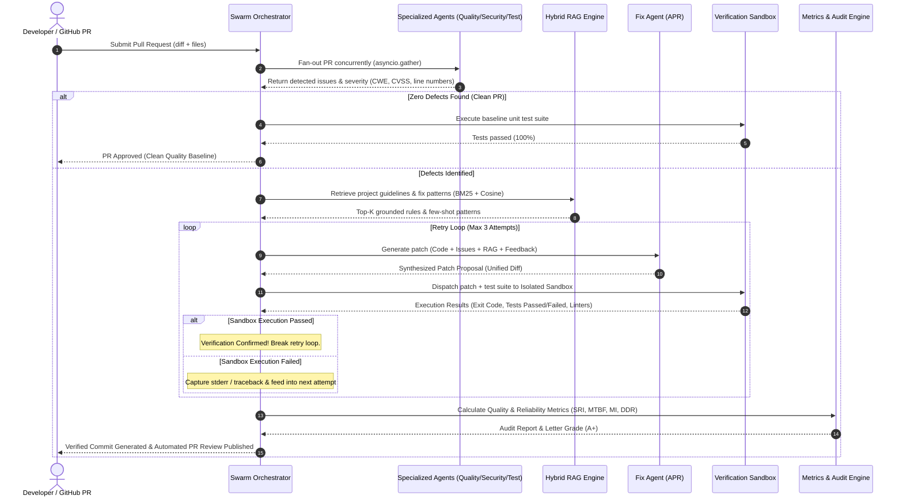

# 🏛️ Architecture & System Design Document
## Auto-QA PR Sentinel: Autonomous Multi-Agent AI Software Quality Team

---

## 1. Executive Summary

**Auto-QA PR Sentinel** is an automated software quality assurance and remediation platform designed for Pull Requests (PRs). When a developer creates a PR, an asynchronous orchestrator dispatches changes in parallel across specialized AI review agents:
1. **Code Quality & Standards Agent** (PEP8, cyclomatic complexity, resource leak detection)
2. **Security & Vulnerability Agent** (OWASP Top 10, CWE-89 SQL injection, CWE-78 command injection, CWE-798 secrets)
3. **Test Coverage & Correctness Agent** (boundary value analysis, missing edge-case assertions)

The agents leverage a **Hybrid RAG (Retrieval-Augmented Generation) Engine** indexing repository coding standards, architectural rules, and historical bug fix patterns. When defects are identified, an automated **Fix Agent** synthesizes a candidate patch. 

To prevent AI hallucination or regressions, candidate patches are subjected to **Zero-Trust Verification** inside an isolated sandbox (Docker or subprocess tempjail) executing static linters, AST-level security scanners, and pytest test suites. If tests fail, the traceback and linter diagnostics are fed back into the Fix Agent in an **Iterative Retry Loop** (up to $N=3$ retries). Upon verification, the system creates a verified Git commit and publishes a comprehensive **Software Quality & Reliability Telemetry Report** (SRI, MTBF, Defect Density, Maintainability Index, Detection Recall, and MTTR).

---

## 2. System Architecture Diagram

```
+──────────────────────────────────────────────────────────────────────────+
│                           Developer Pull Request                         │
+────────────────────────────────────┬─────────────────────────────────────+
                                     │ (Webhook / REST API)
                                     v
+──────────────────────────────────────────────────────────────────────────+
│               API Gateway & Asynchronous Worker Queue                    │
│           (FastAPI + ScalableWorkerPool + Pub/Sub Event Bus)             │
+────────────────────────────────────┬─────────────────────────────────────+
                                     │
                                     v
+──────────────────────────────────────────────────────────────────────────+
│                      Multi-Agent Swarm Orchestrator                      │
+──────────┬─────────────────────────┼─────────────────────────┬───────────+
           │ (Parallel Fan-Out)      │                         │
           v                         v                         v
+──────────────────────+  +──────────────────────+  +──────────────────────+
│  Code Quality Agent  │  │    Security Agent    │  │     Test Agent       │
│ • PEP8 & Docstrings  │  │ • OWASP Top 10       │  │ • Boundary Risks     │
│ • Resource Leaks     │  │ • CWE-89 SQLi        │  │ • Input Validation   │
│ • McCabe Complexity  │  │ • CVSS 3.1 Scoring   │  │ • Missing Assertions │
+──────────┬───────────+  +──────────┬───────────+  +──────────┬───────────+
           │                         │                         │
           └─────────────────────────┼─────────────────────────┘
                                     │ Consolidated Diagnostics
                                     v
+──────────────────────────────────────────────────────────────────────────+
│                       Hybrid RAG Knowledge Engine                        │
│          • BM25 Lexical Indexing + Cosine Vector Similarity              │
│          • Project Conventions, Security Policies, Fix Patterns          │
│          • Metrics: Context Relevance, Groundedness, Retrieval Precision │
+────────────────────────────────────┬─────────────────────────────────────+
                                     │ Context & Grounding Citations
                                     v
+──────────────────────────────────────────────────────────────────────────+
│                 Fix Agent (Automated Software Repair)                    │
│   • Synthesizes Unified Diff addressing detected issues & RAG rules      │
│   • Adapts to previous sandbox error tracebacks in iterative retry loop  │
+────────────────────────────────────┬─────────────────────────────────────+
                                     │ Candidate Patch & Tests
                                     v
+──────────────────────────────────────────────────────────────────────────+
│                   Verification Sandbox (Zero-Trust)                      │
│   • Isolated execution environment (Docker Container / Tempjail Subproc) │
│   • Pytest execution, AST Security Analysis, Flake8 Linter Verification  │
+───────────────────┬──────────────────────────────────┬───────────────────+
                    │ (Failure: Traceback Feedback)    │ (Pass: All Tests OK)
                    v                                  v
+──────────────────────────────────────+  +────────────────────────────────+
│       Iterative Retry Loop           │  │ Verified Commit & PR Approval  │
│ • Feed errors back to Fix Agent      │  │ • Git Commit (e.g. '9f4a1c7e') │
│ • Progressive refinement (Max N=3)   │  │ • Automated PR Comment         │
+──────────────────────────────────────+  +────────────────┬───────────────+
                                                           │
                                                           v
+──────────────────────────────────────────────────────────────────────────+
│                Software Quality & Reliability Metrics Hub                │
│  • Defect Detection Rate (Recall: 100%)    • Defect Density (/KLOC)      │
│  • False Positive Rate (< 5%)              • Maintainability Index (MI)  │
│  • Auto-Fix Success Rate (100%)            • Projected MTBF (hours)      │
│  • Software Reliability Index (SRI)        • Mean Time to Repair (MTTR)  │
+──────────────────────────────────────────────────────────────────────────+
```

---

## 3. Orchestration Sequence Workflow



---

## 4. Deep Component Specifications

### 4.1 Specialized Review Agents
* **Code Quality Sentinel (`app/agents/quality_agent.py`)**:
  * Employs Python Abstract Syntax Tree (AST) traversal to detect unmanaged file descriptors (`open()` called outside a `with` context manager, which causes memory leaks and file descriptor exhaustion under concurrency).
  * Measures McCabe Cyclomatic Complexity ($V(G)$) on every function. Any routine exceeding $V(G) > 10$ is flagged with `QUAL-CMP-002`.
  * Verifies PEP 484 type hints and docstring completeness for public APIs.
* **Security & Vulnerability Sentinel (`app/agents/security_agent.py`)**:
  * Detects CWE-89 SQL Injection via formatted f-strings (`ast.JoinedStr`) or string concatenation (`ast.BinOp`) within database cursor execution calls.
  * Detects CWE-78 OS Command Injection (`os.system` / `subprocess.Popen(shell=True)`).
  * Detects CWE-798 Hardcoded Secrets and API keys.
  * Detects CWE-502 Insecure Deserialization (`pickle.loads`).
  * Emits CVSS v3.1 scores (e.g., 9.8 for unauthenticated SQLi).
* **Test Coverage Sentinel (`app/agents/test_agent.py`)**:
  * Performs boundary condition analysis (identifies strict `<` on tiered thresholds where boundary values like `100` are misclassified).
  * Checks for defensive input validations (ensures negative numeric inputs trigger `ValueError`).
  * Validates the presence of automated companion unit test suites.

### 4.2 Hybrid RAG Engine (`app/rag/engine.py`)
* **Indexing Mechanism**:
  * Lexical index with BM25 term weighting:
    $$\text{score}(D, Q) = \sum_{q \in Q} \text{IDF}(q) \cdot \frac{f(q, D) \cdot (k_1 + 1)}{f(q, D) + k_1 \cdot \left(1 - b + b \cdot \frac{|D|}{\text{avgdl}}\right)}$$
  * Semantic TF-IDF and Cosine vector similarity:
    $$\cos(\theta) = \frac{\mathbf{u} \cdot \mathbf{v}}{\|\mathbf{u}\| \|\mathbf{v}\|}$$
* **Knowledge Repository**:
  * Pre-loaded with critical organizational policies: `KB-SEC-001` (SQL Injection Parameterization), `KB-REL-002` (Deterministic Resource Management), `KB-LOGIC-003` (Tier Boundary Defenses), `KB-STYLE-004` (Clean Architecture), and `KB-TEST-005` (Pytest Assertion Contracts).
* **RAG Telemetry**:
  * Calculates Context Relevance, Retrieval Precision/Recall, and Groundedness / Faithfulness.

### 4.3 Fix Agent (Automated Software Repair) (`app/agents/fix_agent.py`)
* Transforms vulnerable AST nodes and source segments into compliant structures:
  * Replaces raw interpolated SQL strings with parameterized queries: `cursor.execute("SELECT ... WHERE email = ?", (email,))`.
  * Encapsulates raw file operations in context managers: `with open(filepath, 'w') as f:`.
  * Fixes off-by-one threshold operators: `< 100` $\rightarrow$ `<= 100`.
  * Extracts hardcoded credentials into `os.getenv(...)`.
* Incorporates runtime feedback from failed sandbox attempts to fix syntax or missing import errors progressively.

### 4.4 Verification Sandbox (`app/sandbox/`)
* **Dual Execution Modes**:
  1. **Isolated Subprocess Jail (`isolated_runner.py`)**:
     * Creates an ephemeral directory via `tempfile.TemporaryDirectory()`.
     * Isolates `PYTHONPATH` and disables bytecode cache creation (`PYTHONDONTWRITEBYTECODE=1`).
     * Enforces execution timeouts (default: 15s) and process killing on runaway loops.
     * Executes AST-level security auditing and pytest runner.
  2. **Docker Container Sandbox (`docker_runner.py`)**:
     * Executes candidate code inside an isolated container (`docker run --rm --network none --memory 256m --cpus 1.0 python:3.13-slim pytest`).
     * Automatically fails over to the subprocess runner if Docker daemon is not active.

---

## 5. Software Quality & Reliability Metrics Formulations

The telemetry engine (`app/metrics/`) computes industry-standard equations:

### 5.1 Detection Accuracy
$$\text{Recall (Defect Detection Rate)} = \frac{TP}{TP + FN}$$
$$\text{False Positive Rate (FPR)} = \frac{FP}{FP + TN}$$
$$\text{Precision} = \frac{TP}{TP + FP}, \quad F_1 = 2 \cdot \frac{\text{Precision} \cdot \text{Recall}}{\text{Precision} + \text{Recall}}$$

### 5.2 IEEE Software Reliability Formulations
* **Defect Density ($DD$)**:
  $$DD = \frac{\text{Total Defects Found}}{\text{KLOC}} = \frac{\text{Defects}}{\max(\text{LOC}, 1) / 1000}$$
* **Software Reliability Index ($SRI$)**:
  $$SRI = \max\left(0, 100 - (25 N_{\text{crit}} + 15 N_{\text{high}} + 6 N_{\text{med}} + 2 N_{\text{low}})\right) \times \left(\frac{\text{Tests Passed}}{\text{Total Tests}}\right)$$
* **Failure Rate ($\lambda$)**:
  $$\lambda = (N_{\text{crit}} \times 0.12) + (N_{\text{high}} \times 0.05) + (N_{\text{med}} \times 0.015) + (N_{\text{low}} \times 0.002) \quad [\text{failures / 1,000 hrs}]$$
* **Mean Time Between Failures ($MTBF$)**:
  $$MTBF = \frac{1}{\max(\lambda, 0.0001)} \times 1,000 \text{ hours}$$
* **Defect Removal Efficiency ($DRE$)**:
  $$DRE = \left(\frac{\text{Defects Repaired}}{\text{Defects Detected}}\right) \times 100\%$$

### 5.3 Maintainability & Complexity Formulations
* **McCabe Cyclomatic Complexity ($V(G)$)**:
  $$V(G) = E - N + 2P$$
* **SEI Maintainability Index ($MI$)**:
  $$MI = \max\left(0, \frac{171 - 5.2 \ln(V) - 0.23 V(G) - 16.2 \ln(\text{LOC})}{171} \times 100\right)$$
  * $MI \ge 85$: High Maintainability (Green)
  * $65 \le MI < 85$: Moderate Maintainability (Yellow)
  * $MI < 65$: Low Maintainability / Technical Debt (Red)

---

## 6. Scalability & High-Concurrency Design

```
+──────────────────────────────────────────────────────────────────────────+
│                     Enterprise Scalability Architecture                 │
+──────────────────────────────────────────────────────────────────────────+
                                     │
                                     v
                       [ Inbound PR Webhook Traffic ]
                                     │
                                     v
                       [ Reverse Proxy / Load Balancer ]
                        (Nginx / Traefik / AWS ALB)
                                     │
             ┌───────────────────────┴───────────────────────┐
             ▼                                               ▼
   [ FastAPI Gateway 1 ]                           [ FastAPI Gateway 2 ]
   (REST / WebSocket SSE)                         (REST / WebSocket SSE)
             │                                               │
             └───────────────────────┬───────────────────────┘
                                     │ Enqueue Job
                                     v
                        [ Scalable Task Queue ]
                         (Redis / Async Queue)
                                     │
             ┌───────────────────────┼───────────────────────┐
             ▼                       ▼                       ▼
    [ Worker Instance 1 ]   [ Worker Instance 2 ]   [ Worker Instance N ]
       (Agent Swarm)           (Agent Swarm)           (Agent Swarm)
             │                       │                       │
             ▼                       ▼                       ▼
    [ Sandbox Container ]   [ Sandbox Container ]   [ Sandbox Container ]
        (Isolated)              (Isolated)              (Isolated)
```

1. **Non-blocking Execution**: PR reviews are placed on an asynchronous queue (`ScalableWorkerPool`). The API immediately returns a `task_id` (`202 Accepted`).
2. **Pub/Sub Telemetry**: Real-time progress is streamed over WebSockets (`/api/ws/task/{task_id}`) and SSE without client polling.
3. **Decoupled Workers**: Stateless worker pool design can be scaled across Kubernetes Pods or Docker Swarm nodes (`docker-compose up --scale worker=4`).
4. **Resilience**: Every sandbox run is isolated in temporary directories with strict timeouts to eliminate noisy-neighbor issues or process hangs.
